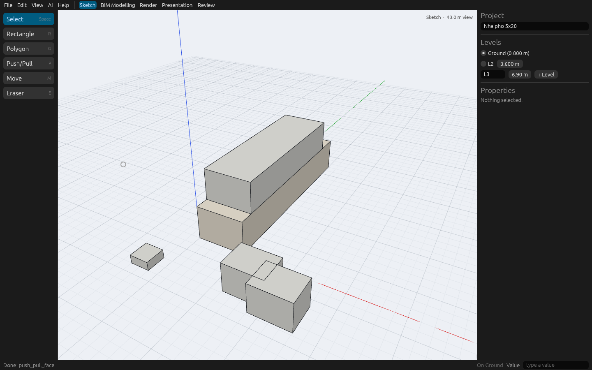

# Ferro

**An open-source, AI-native 3D design tool for architects. Written in Rust.**

*Ferro* means iron: the metal behind Rust, and behind ferro-cement. A
tool that lets designers sketch freely and fast, while real BIM data builds up
underneath, ready to hand to Revit for documentation.

> Status: **milestone 1 — first usable desktop app.** Sketch modelling with
> SketchUp-style snapping and push/pull, levels, undo, `.fro` files, OBJ / glTF
> export, and an MCP server so AI agents can model too. BIM elements (walls,
> floors, doors), rendering and in-app AI arrive in the next milestones.



## Download

Builds for **Windows (x64)** and **macOS (Apple Silicon + Intel)** are produced
by CI on every change: open the latest run of
[Release builds](https://github.com/ktsdatpham/ferro/actions/workflows/release.yml)
and download the artifact. Tagged versions are published under
[Releases](https://github.com/ktsdatpham/ferro/releases). Builds are not
code-signed yet; see `packaging/README-install.txt` for the one-time
"Open anyway" step.

---

## Why

Revit is great at documentation and painful for design. Designers have to pick
wall types, levels and families before the idea even exists. So they sketch
in SketchUp or Rhino, and the model gets rebuilt in Revit later.

Ferro wants to be the design stage that doesn't throw work away:

| From | We take |
|---|---|
| **SketchUp** | Push-pull, inference snapping, drawing to scale fast, simple enough for anyone |
| **Rhino** | Command line with autocomplete, precise input, Grasshopper-style parametric nodes (later) |
| **AI agents** | A built-in **MCP server**: any AI (Claude, Cursor, local models) can read and model in your file |
| **Revit** | Not replaced, **complemented**: one-click link / export, plus a Revit add-in on the same Rust core |
| **Open source** | Public code + docs = AI agents and humans can both understand and extend it |

## Not doing

Keeping the scope tight matters more than piling on features. Ferro core is
**not** a documentation or sheet tool, and is **not** a full Revit clone.
Anything outside the core loop (sketch → AI → BIM data → Revit) should be an
add-in.

## What works today (milestone 1)

| Area | Status |
|---|---|
| Tools | Select, Rectangle, Polygon, Push/Pull, Move (Ctrl = copy), Eraser; type exact values while drawing (`4000,3000`, `3m`) |
| Snapping | Endpoint, midpoint, on edge, on face, red / green / blue axis inference, ground / active level |
| Model | Immutable document, elements with stable UUIDs, levels (Forms move with their level), Forms classifiable as walls / floors / roofs …, typed parameters, computed area and volume |
| History | Every change is one command + transaction: undo / redo, journal of who did what (user or AI agent) |
| Files | `.fro` (SQLite, autosave, crash-safe), `.fro.json` interchange, OBJ and glTF export |
| AI | `ferro-mcp`: every command is an MCP tool (units like `"3m"`, angles in degrees) |
| Platforms | Windows, macOS, Linux; kernel builds for WebAssembly |

## Architecture

```
 ferro-app (egui + wgpu)    ferro-mcp (AI agents)    Revit add-in (C#)
        │                         │                        │ P/Invoke
        │                         │                   ferro-ffi (C ABI)
        └──────────┬──────────────┴────────────────────────┘
                   ▼
   ferro-snap (inference)   ferro-io (.fro, JSON, OBJ, glTF)
                   ▼
   ferro-core:  math → geom → topo → algo → model → ops
   (pure: no IO, no UI, deterministic, builds for wasm32)
```

| Crate | What it is |
|---|---|
| `crates/ferro-core` | Kernel: math, curves and profiles, half-edge B-rep with persistent ids, extrude / push-pull / triangulation, immutable `Document`, commands, transactions, undo |
| `crates/ferro-io` | `.fro` SQLite files (incremental autosave), `.fro.json`, OBJ / glTF export |
| `crates/ferro-snap` | Inference engine: SketchUp-style snapping in screen space |
| `crates/ferro-mcp` | MCP server over stdio: kernel commands as tools, plus list / get / undo / save / export |
| `crates/ferro-ffi` | C ABI for the Revit add-in and native shells |
| `crates/ferro-app` | The desktop app (`ferro`): viewport, tools, levels, properties |
| `revit-addin/` | C# shell that loads the Rust core inside Revit |

## Build from source

You need [Rust](https://rustup.rs) (stable). On Linux also
`libgtk-3-dev libxkbcommon-dev libwayland-dev`.

```bash
git clone https://github.com/ktsdatpham/ferro
cd ferro
cargo test --workspace
cargo run -p ferro-app --release            # the app
cargo run -p ferro-app --release -- my.fro  # open a project
```

### Let an AI model with Ferro

```bash
cargo build -p ferro-mcp --release
```

Add it to your MCP client, e.g. Claude Desktop:

```json
{
  "mcpServers": {
    "ferro": { "command": "/absolute/path/to/ferro/target/release/ferro-mcp" }
  }
}
```

Then ask: *"Create level L2 at 3.6 m, a 5 × 20 m ground floor 3.6 m high and a
5 × 16 m upper floor on L2, classify the ground floor as walls, and save it to
~/house.fro."* Open the file in the app.

## Roadmap

See [docs/ROADMAP.md](docs/ROADMAP.md). In short:

1. ✅ **Viewport + SketchUp basics**: window, orbit, rectangle, push-pull, snapping (`docs/milestones/M1.md`)
2. **AI in the app**: chat panel driving the same MCP tools, live-updating the view (Ferro Link)
3. **Revit link**: solids → DirectShape, tags → native walls / floors / rooms
4. **Rhino-style power**: command line, parametric nodes, IFC export
5. **Real-time rendering**: materials and lighting in the viewport, wgpu PBR

## Contributing

Before writing code, read the **[Foundation Spec](docs/foundation/README.md)**:
the agreed units, coordinates, Revit-style data model, naming rules and
transaction model that every contribution (human or AI) must follow.

Every kind of help is welcome: Rust, geometry, UI, Revit API, docs,
translations, or just testing and telling us what hurts. Start with
[CONTRIBUTING.md](CONTRIBUTING.md).

## License

Licensed under the [Mozilla Public License 2.0](LICENSE). Ferro is **open core**: the desktop app, kernel, BIM tools, MCP server and plugin SDK are open; hosted services (AI, sync, cloud rendering, premium assets) are offered separately as Ferro Cloud.
